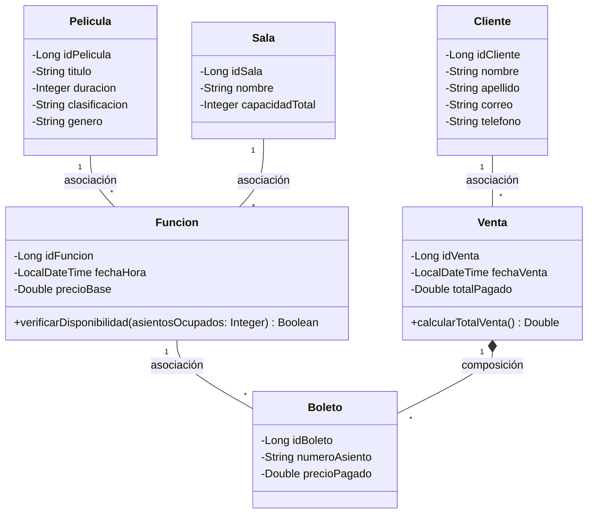
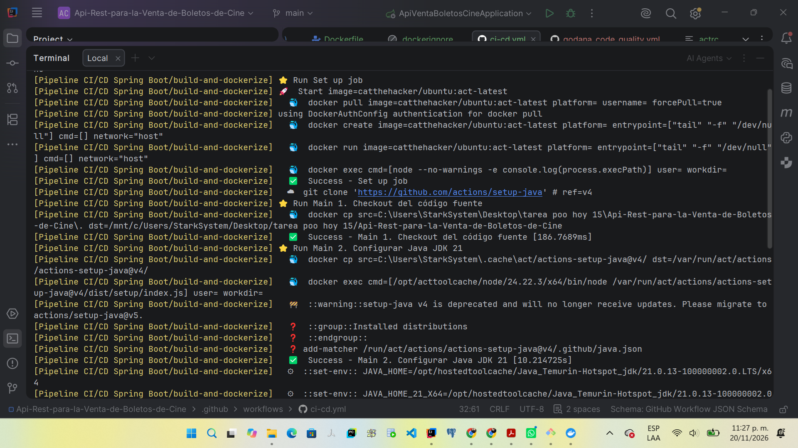
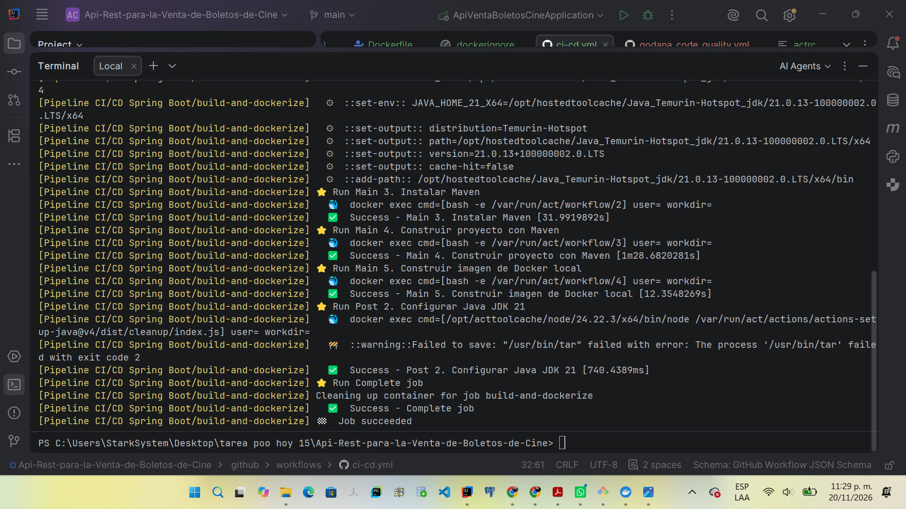
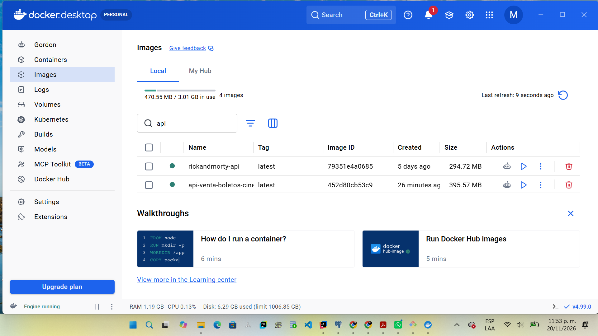
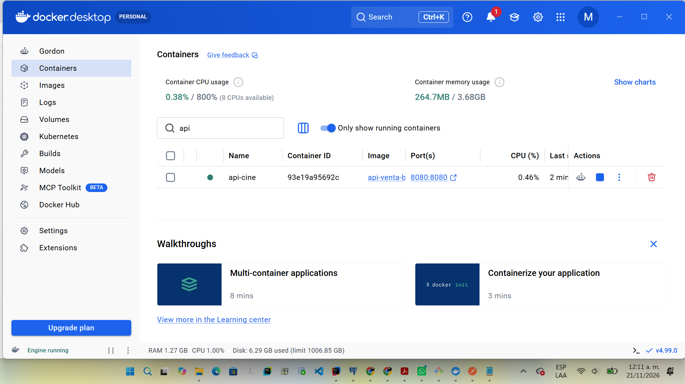
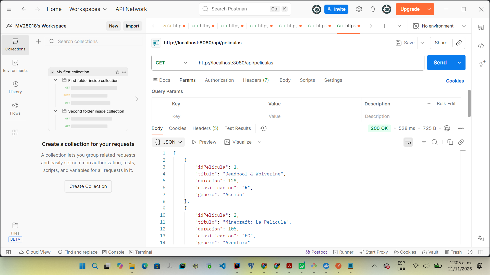
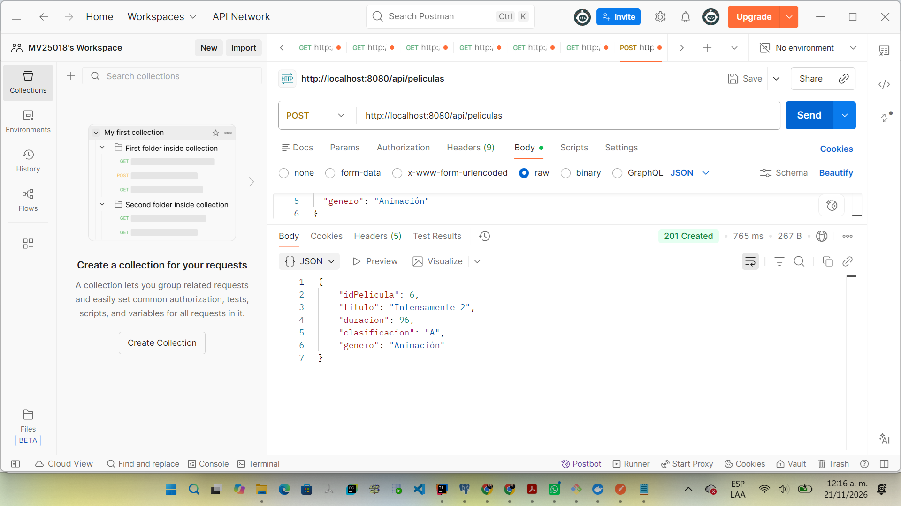

# API para la Venta de Boletos de Cine

API RESTful desarrollada en Java 21 y Spring Boot para la gestión y reserva de boletos de cine, control de funciones, administración de películas, salas y clientes, garantizando la validación de asientos disponibles para evitar sobreventas.

> **Estado del Proyecto:** **Implementado y Operativo**
>
> La API REST, validaciones de negocio, manejo global de excepciones, pruebas unitarias, documentación Swagger, contenerización con Docker, manifiestos de Kubernetes y pipeline CI/CD se encuentran completados y verificados.

## Integrantes

* José Mira - mv25018 (@Mira-MV25018)
* Luis Castro - cm13032 (@CM13032)
* Angela Mena - mo23002 (@MO23002)
* Giovanni Zecena - zr25002 (@ZR25002)
* Ronald Bollates - be20001 (@BE20001)

## Objetivos del Proyecto

Diseñar, construir, documentar y desplegar un backend funcional aplicando estándares de desarrollo actuales y prácticas de cultura DevOps:

* Implementación de una **API RESTful** con operaciones HTTP completas (`GET`, `POST`, `PUT`, `DELETE`).
* Estructuración mediante **arquitectura en capas**, uso del patrón **DTO**, librería **Lombok** y **manejo global de excepciones** (`400`, `404`, `409`).
* Documentación interactiva de endpoints mediante **OpenAPI / Swagger UI**.
* Garantía de calidad de software mediante **pruebas unitarias** con **JUnit 5** y **Mockito**.
* **Contenerización** de la aplicación utilizando **Docker**.
* Orquestación del despliegue en un entorno local de **Kubernetes** (Docker Desktop).
* Automatización del ciclo de vida del software (Build, Test, Dockerize y Deploy) con **GitHub Actions** y ejecución local mediante **act** gestionando la conexión al clúster con `KUBECONFIG`.

## Descripción del Proyecto y Lógica de Negocio

El sistema permite gestionar el flujo completo de ventas de boletos de una cadena de cine:

* **Películas y Salas:** Una película se proyecta en diferentes salas de cine dentro de distintas funciones (horarios).
* **Ventas y Boletos:** Un cliente puede realizar compras de uno o más boletos para una función específica.
* **Control de Asientos (Evitar Sobreventa):** La API valida la disponibilidad del asiento y la capacidad de la sala asignada a la función antes de confirmar cualquier boleto, lanzando un conflicto (`409 Conflict`) si el asiento ya se encuentra ocupado.

## Tecnologías y Herramientas

* **Lenguaje:** Java 21 (Eclipse Temurin)
* **Gestor de Proyecto y Dependencias:** Maven
* **Framework Backend:** Spring Boot 3.2.5 (Spring Web, Spring Data JPA, Spring Validation)
* **Documentación API:** SpringDoc OpenAPI / Swagger UI 2.5.0
* **Librerías Adicionales:** Lombok
* **Pruebas Unitarias:** JUnit 5, Mockito (18 casos de prueba)
* **Base de Datos:** PostgreSQL
* **Contenerización y Orquestación:** Docker, Kubernetes
* **DevOps y CI/CD:** GitHub Actions y `act` para ejecución local
* **Pruebas de API:** Postman y Swagger UI

## Arquitectura y Estructura del Proyecto

El código fuente sigue una arquitectura en capas dentro del paquete base `com.unisal.api_venta_boletos_cine`:

```text
├── .github/workflows/ci-cd.yml   # Pipeline CI/CD (GitHub Actions / act)
├── k8s/
│   ├── deployment.yaml           # Despliegue del contenedor en Kubernetes
│   └── service.yaml              # Exposición LoadBalancer (puerto 30080)
├── doc/evidencias/               # Capturas de pruebas, Docker y CI/CD
├── Dockerfile                    # Imagen basada en eclipse-temurin:21-jre-alpine
├── pom.xml                       # Dependencias y plugins de Maven
└── src/
    ├── main/java/com/unisal/api_venta_boletos_cine/
    │   ├── config/               # Configuración de Swagger / OpenAPI
    │   ├── controller/           # Controladores REST (6 recursos)
    │   ├── dto/                  # Objetos de transferencia de datos
    │   ├── entity/               # Entidades JPA mapeadas a PostgreSQL
    │   ├── exception/            # Excepciones personalizadas y GlobalExceptionHandler
    │   ├── repository/           # Interfaces Spring Data JPA
    │   └── service/              # Lógica y reglas de negocio
    ├── main/resources/
    │   └── application.properties
    └── test/java/com/unisal/api_venta_boletos_cine/service/
        ├── FuncionServiceTest.java
        └── PeliculaServiceTest.java
```

## Diagramas

### 1. Modelo Entidad-Relación (Estructura de Tablas)

* **Pelicula** (`idPelicula`, `titulo`, `duracion`, `clasificacion`, `genero`)
* **Sala** (`idSala`, `nombre`, `capacidadTotal`)
* **Cliente** (`idCliente`, `nombre`, `apellido`, `correo`, `telefono`)
* **Funcion** (`idFuncion`, `idPelicula`, `idSala`, `fechaHora`, `precioBase`)
* **Venta** (`idVenta`, `idCliente`, `fechaVenta`, `totalPagado`)
* **Boleto** (`idBoleto`, `idVenta`, `idFuncion`, `numeroAsiento`, `precioPagado`)

### 2. Diagrama de Clases (UML)



## Estado de Avance / Roadmap

- [x] **Fase 1:** Definición de requisitos, alcance y arquitectura de la solución
- [x] **Fase 2:** Diseño del Diagrama Entidad-Relación (ER)
- [x] **Fase 3:** Diseño del Diagrama de Clases (UML)
- [x] **Fase 4:** Construcción de la API REST (Arquitectura en capas, DTOs, Lombok, Controladores GET/POST/PUT/DELETE)
- [x] **Fase 5:** Manejo global de excepciones y validación de reglas de negocio (control de asientos)
- [x] **Fase 6:** Pruebas unitarias con JUnit 5 y Mockito
- [x] **Fase 7:** Contenerización con Docker y creación del Dockerfile
- [x] **Fase 8:** Despliegue y orquestación en Kubernetes (Docker Desktop)
- [x] **Fase 9:** Automatización de Pipeline CI/CD en GitHub Actions y ejecución local con `act`

## Endpoints de la API REST

Todos los recursos implementan operaciones CRUD estándar sobre JSON.

### Películas (`/api/peliculas`)

| Método | Endpoint | Descripción |
| :--- | :--- | :--- |
| `GET` | `/api/peliculas` | Listar todas las películas |
| `GET` | `/api/peliculas/{id}` | Obtener detalle de una película por ID |
| `POST` | `/api/peliculas` | Registrar una nueva película |
| `PUT` | `/api/peliculas/{id}` | Actualizar datos de una película |
| `DELETE` | `/api/peliculas/{id}` | Eliminar una película |

### Salas (`/api/salas`)

| Método | Endpoint | Descripción |
| :--- | :--- | :--- |
| `GET` | `/api/salas` | Listar todas las salas |
| `GET` | `/api/salas/{id}` | Obtener detalle de una sala por ID |
| `POST` | `/api/salas` | Registrar una nueva sala |
| `PUT` | `/api/salas/{id}` | Actualizar datos de una sala |
| `DELETE` | `/api/salas/{id}` | Eliminar una sala |

### Clientes (`/api/clientes`)

| Método | Endpoint | Descripción |
| :--- | :--- | :--- |
| `GET` | `/api/clientes` | Listar todos los clientes |
| `GET` | `/api/clientes/{id}` | Obtener detalle de un cliente por ID |
| `POST` | `/api/clientes` | Registrar un nuevo cliente |
| `PUT` | `/api/clientes/{id}` | Actualizar datos de un cliente |
| `DELETE` | `/api/clientes/{id}` | Eliminar un cliente |

### Funciones (`/api/funciones`)

| Método | Endpoint | Descripción |
| :--- | :--- | :--- |
| `GET` | `/api/funciones` | Consultar funciones programadas |
| `GET` | `/api/funciones/{id}` | Obtener detalle de una función por ID |
| `POST` | `/api/funciones` | Programar una nueva función |
| `PUT` | `/api/funciones/{id}` | Actualizar una función existente |
| `DELETE` | `/api/funciones/{id}` | Eliminar una función |

### Ventas (`/api/ventas`)

| Método | Endpoint | Descripción |
| :--- | :--- | :--- |
| `GET` | `/api/ventas` | Listar todas las ventas registradas |
| `GET` | `/api/ventas/{id}` | Consultar detalle de una venta |
| `POST` | `/api/ventas` | Registrar una nueva venta |
| `PUT` | `/api/ventas/{id}` | Actualizar una venta |
| `DELETE` | `/api/ventas/{id}` | Eliminar o cancelar una venta |

### Boletos (`/api/boletos`)

| Método | Endpoint | Descripción |
| :--- | :--- | :--- |
| `GET` | `/api/boletos` | Listar todos los boletos emitidos |
| `GET` | `/api/boletos/{id}` | Consultar detalle de un boleto por ID |
| `POST` | `/api/boletos` | Emitir un boleto (valida disponibilidad del asiento) |
| `PUT` | `/api/boletos/{id}` | Actualizar un boleto |
| `DELETE` | `/api/boletos/{id}` | Anular o eliminar un boleto |

## Instrucciones de Ejecución Local

### 1. Requisitos previos
* Java JDK 21
* Maven 3.9+
* PostgreSQL con la base de datos **`venta_boletos`** creada

### 2. Variables de entorno (opcional)
El archivo `src/main/resources/application.properties` cuenta con valores por defecto que pueden sobrescribirse mediante variables de entorno:
* `DB_URL` (por defecto: `jdbc:postgresql://localhost:5432/venta_boletos`)
* `DB_USER` (por defecto: `postgres`)
* `DB_PASSWORD` (por defecto: `admin123`)

### 3. Compilar, ejecutar pruebas y levantar la API

```bash
# Ejecutar pruebas unitarias
mvn test

# Iniciar la aplicación localmente
mvn spring-boot:run
```

* **API Local:** `http://localhost:8080/api/`
* **Documentación Swagger UI:** `http://localhost:8080/swagger-ui/index.html`

## Instrucciones de Despliegue (Docker, Kubernetes y CI/CD)

### 1. Requisitos previos
* Docker Desktop con **Kubernetes habilitado**
* `act` instalado (para simular GitHub Actions de forma local)

### 2. Ejecutar el pipeline CI/CD en local
Empaqueta el `.jar`, ejecuta las pruebas unitarias, construye la imagen Docker `api-venta-boletos-cine:latest` y aplica los manifiestos en Kubernetes:

```bash
act -W .github/workflows/ci-cd.yml
```

### 3. Despliegue manual en Kubernetes (opcional)
Si ya generaste la imagen con `mvn clean package` y `docker build -t api-venta-boletos-cine:latest .`:

```bash
kubectl apply -f k8s/deployment.yaml
kubectl apply -f k8s/service.yaml
```

### 4. Acceder a la API desplegada en Kubernetes
* **API:** `http://localhost:30080/api/`
* **Swagger Docs:** `http://localhost:30080/swagger-ui/index.html`

## Evidencias

### Pipeline CI/CD
| Inicio del Pipeline | Finalización del Pipeline |
| :---: | :---: |
|  |  |

### Contenerización con Docker
| Imagen Construida | Contenedor en Ejecución |
| :---: | :---: |
|  |  |

### Pruebas de Endpoints en Postman
| Petición GET | Petición POST |
| :---: | :---: |
|  |  |